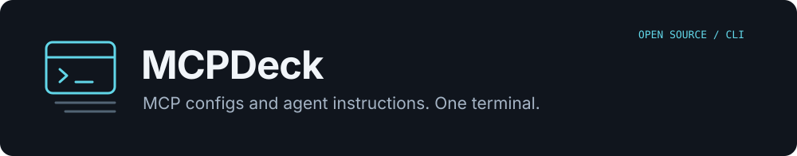

<p align="center">
  
</p>

<p align="center">
  <a href="https://github.com/altanmehmet/mcpdeck/actions/workflows/test.yml"></a>
  <a href="https://github.com/altanmehmet/mcpdeck/actions/workflows/security.yml"></a>
  <a href="https://github.com/altanmehmet/homebrew-mcpdeck/releases"></a>
  <a href="LICENSE"></a>
</p>

<p align="center">
  <a href="#install">Install</a> · <a href="#first-connection">Quick start</a> · <a href="docs/README.md">Documentation</a> · <a href="docs/COMPATIBILITY.md">Supported agents</a> · <a href="CONTRIBUTING.md">Contribute</a> · <a href="README.tr.md">Türkçe</a>
</p>

MCPDeck is a local Go CLI for managing MCP servers and shared personal instructions across coding agents. Review an installation once, sync its connection to supported agents, and keep your global rules in one place.

**Public alpha.** macOS, Linux and Windows. One native CLI; no hosted dashboard, Electron bundle or application database. MCP servers and planning providers can have their own runtimes, account requirements and usage costs.

## Install

### macOS and Linux

```sh
brew install altanmehmet/mcpdeck/mcpdeck
mcpdeck
```

Update with `brew update` and `brew upgrade altanmehmet/mcpdeck/mcpdeck`.

### Windows

In PowerShell or Windows Terminal:

```powershell
irm https://raw.githubusercontent.com/altanmehmet/homebrew-mcpdeck/main/install.ps1 | iex
mcpdeck
```

The bootstrap verifies the pinned x64/ARM64 archive checksum and updates your user PATH. No administrator privileges, Go or WSL are needed. Prefer to inspect before running? [Review the bootstrap](https://github.com/altanmehmet/homebrew-mcpdeck/blob/main/install.ps1) or use a [manual ZIP installation](docs/WINDOWS.md).

### Other installation options

[Download signed CLI archives](https://github.com/altanmehmet/homebrew-mcpdeck/releases) for macOS/Linux x64 and ARM64, or Windows x64 and ARM64. [Verify publisher signatures and checksums](docs/RELEASING.md). Source builds use the patched Go toolchain selected in `go.mod`; see [Contributing](CONTRIBUTING.md).

## First connection

1. Run `mcpdeck`, choose **New MCP** (`n`), and enter an MCP name or describe the service.
2. Choose an installed planner: Codex, Claude Code, Gemini CLI, Copilot CLI or Antigravity CLI (`agy`). Select a model or keep its default. API planning is also available.
3. Review the documented sources, exact setup commands and target agents.
4. Enter credentials only in the separate masked fields. Enable **OS VAULT** with `Ctrl+K` in the New MCP form to keep private values out of configuration files (alpha.8+).
5. Approve the recipe. MCPDeck runs setup, checks MCP initialization and tool discovery, and synchronizes the connection. Reload your agents afterward.

A successful connection check establishes MCP protocol/tool discovery. It does not establish that a database, account or every tool call works. [Installation guide](docs/INSTALL-CONSOLE.md).

<p align="center">
  
</p>

*Installation conversation example with demo data. `F2` shows the plan; `Ctrl+S` continues to approval; `Ctrl+C` requests cancellation.*

## What it handles

| Need | MCPDeck behavior |
| --- | --- |
| The same MCP in several agents | Discover existing connections, then sync through agent-specific adapters. |
| An unfamiliar MCP installation | Ask a planner for a sourced recipe; review it before execution. |
| A broken managed MCP | `mcpdeck repair <name>` proposes an update and verifies it before saving. |
| Personal rules drifting between agents | Edit global files or distribute a shared section while preserving existing personal text. |
| Private connection values | `--vault` stores values in the OS credential store and syncs local runtime references (alpha.8+). |
| A partial configuration update | Inspect status, retry failed targets or restore backups. |

```sh
mcpdeck planner detected
mcpdeck install "Install the MCP for my service" --vault
mcpdeck instructions append 'Never log credentials.'
mcpdeck instructions files
mcpdeck sync --retry-failed
mcpdeck doctor
```

## Agent support

MCP configuration adapters cover Codex, Claude Desktop/Code, Copilot VS Code/CLI, Cursor, Windsurf, Antigravity, Gemini CLI, OpenCode, Zed, Cline, Roo Code, Continue, Amazon Q, Kiro, Qwen Code and TraeCode.

**MCP configuration, installation planning and global instructions are different capabilities.** A configuration adapter does not mean a model session has been tested with every version of that agent. Some global instruction targets require a manual step. See the [compatibility guide](docs/COMPATIBILITY.md) and [instruction paths](docs/INSTRUCTIONS.md).

## Credentials and safety

Private installation fields stay out of the planning prompt and chat. With `--vault`, values are saved in macOS Keychain, Windows Credential Manager or Linux Secret Service, then retrieved by the local MCP runtime. Remote vault connections require HTTPS; loopback HTTP remains available for local MCPs. [Vault setup and boundaries](docs/VAULT.md).

MCPDeck executes reviewed installation commands with your user permissions. It is **not an OS sandbox**. An unrestricted program running as the same user, an administrator or a compromised MCP may access private data. MCP tool responses can also contain sensitive information. Keep credentials out of ordinary chat, issues and documentation supplied to a planner.

Archive publisher signatures are available. macOS packages are not notarized and Windows executables are not Authenticode signed. This is an alpha release, not a production certification. [Security policy](SECURITY.md).

## Documentation and community

- [Documentation index](docs/README.md) — setup, instructions, credentials and recovery.
- [Türkçe başlangıç](README.tr.md) — kurulum ve ilk kullanım.
- [Changelog](CHANGELOG.md) and [release notes](https://github.com/altanmehmet/mcpdeck/releases).
- [Support](SUPPORT.md) — questions, bug reports and troubleshooting.
- [Roadmap](ROADMAP.md) — current scope and work that remains.
- [Contributing](CONTRIBUTING.md) — development, tests and review policy.
- [Community guidelines](CODE_OF_CONDUCT.md).

Report reproducible bugs in [Issues](https://github.com/altanmehmet/mcpdeck/issues) and ask usage questions in [Discussions](https://github.com/altanmehmet/mcpdeck/discussions). [Report vulnerabilities privately](https://github.com/altanmehmet/mcpdeck/security/advisories/new).

Released under the [MIT license](LICENSE). Binary archives include third-party license notices.
